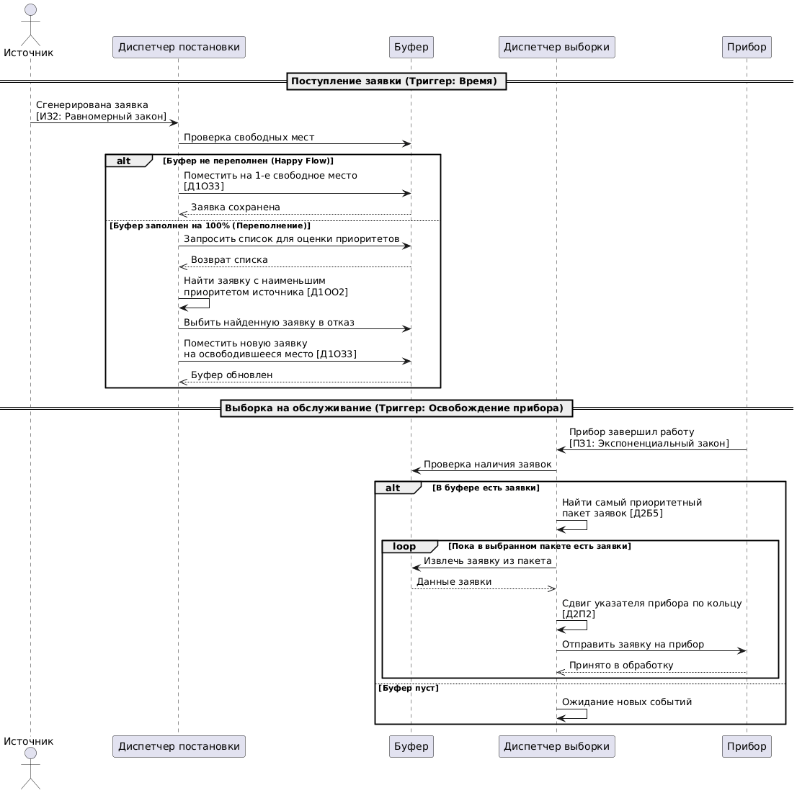
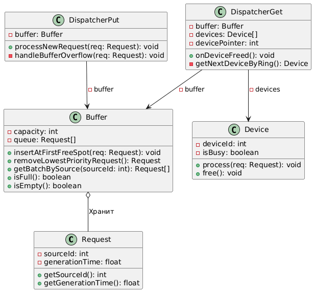
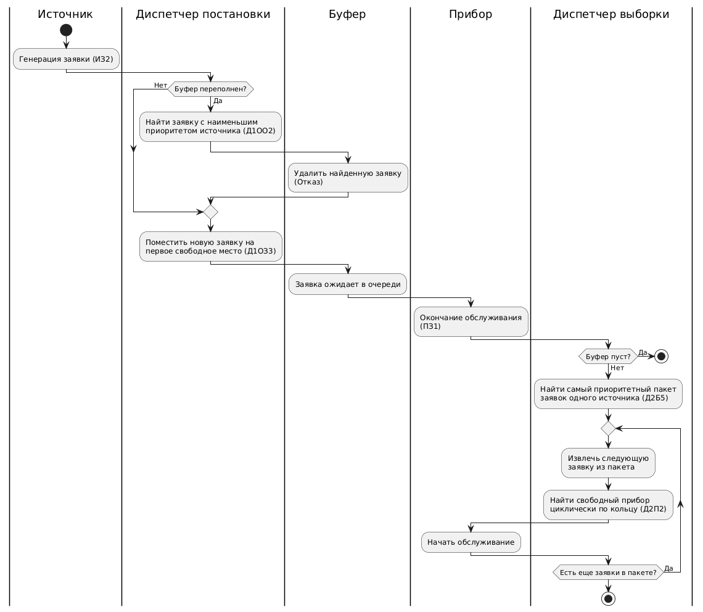

# Система массового обслуживания (Вариант 10)
### Игнашин Иван Юрьевич 5130904/40106
**Бизнес-домен:** Система обработки заказов маркетплейса (микросервисная архитектура).

`ИБ | ИЗ2 | ПЗ1 | Д1ОЗ3 | Д1ОО2 | Д2П2 | Д2Б5 | ОР1 | ОД1`

[Скачать документ с описанием бизнес-домена (DOCX)](docs/Бизнес-домен_СМО_Вариант_10.docx)

[Скачать документ с описанием Маппинга (DOCX)](docs/Маппинг_СМО_Вариант_10.docx)

## Артефакт 1. Сиквенс-диаграмма

## Артефакт 2. Диаграмма классов

## Артефакт 3. Flowchart с дорожками
